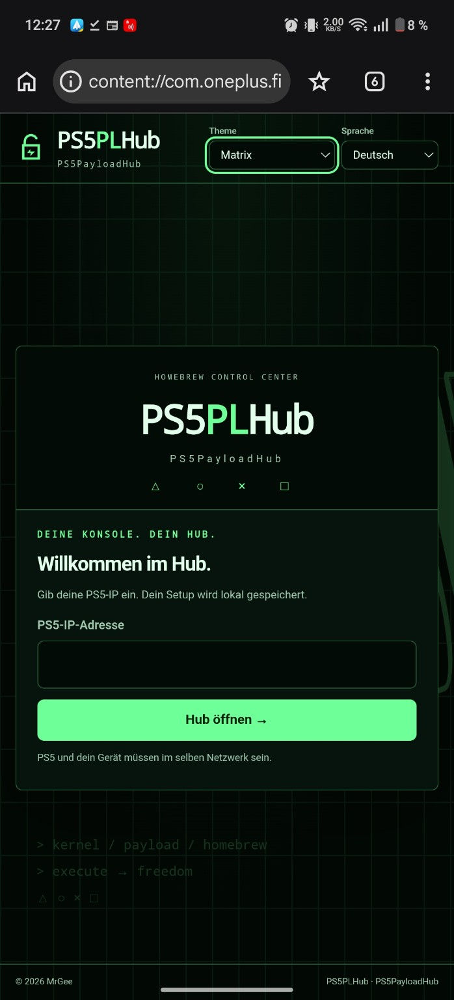
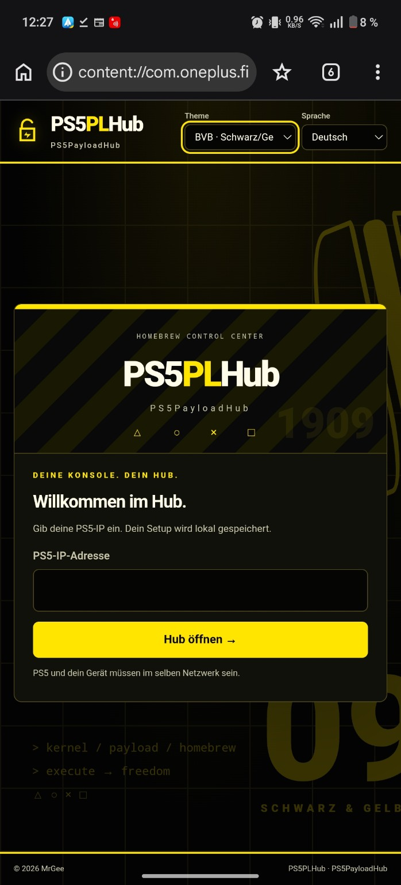
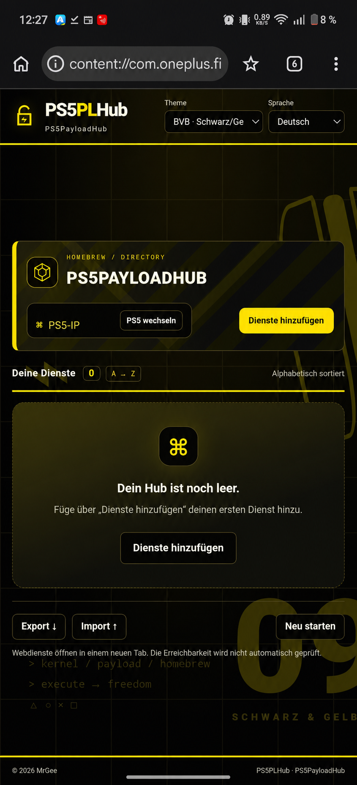
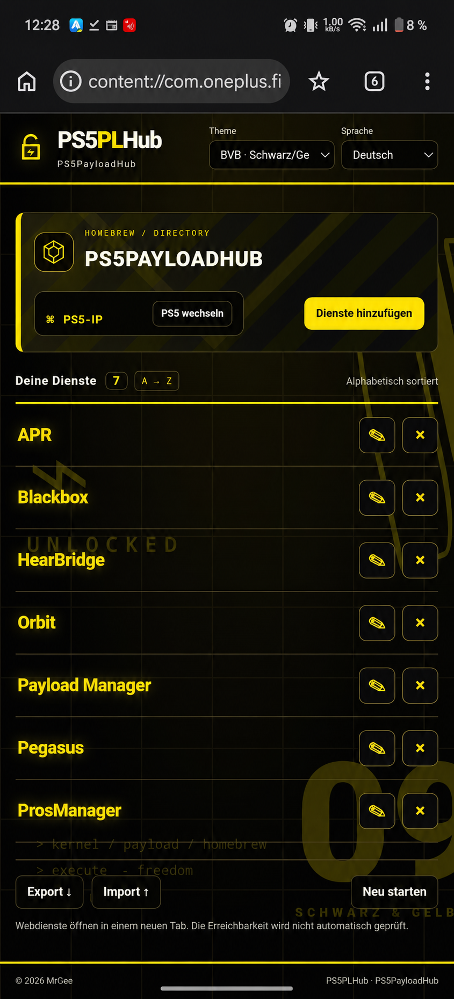

# PS5PLHub

Ein kompakter, eigenständiger Hub für PS5-Webdienste von MrGee. / A compact, standalone hub for PS5 web services by MrGee.

## Deutsch

- [HTML herunterladen](https://github.com/mrguddi84-bit/PS5PLHub/releases/latest/download/PS5PLHub.html) und lokal im Browser öffnen.
- [Android-APK herunterladen](https://github.com/mrguddi84-bit/PS5PLHub/releases/latest/download/PS5PLHub-Android16.apk) und auf Android installieren. Android kann eine Bestätigung für Apps aus dieser Quelle verlangen.
- PS5-IP eingeben, Dienste mit Namen und Ports hinzufügen und einen Dienst zum Öffnen auswählen. Einstellungen bleiben lokal auf dem Gerät.

## English

- [Download the HTML](https://github.com/mrguddi84-bit/PS5PLHub/releases/latest/download/PS5PLHub.html) and open it locally in a browser.
- [Download the Android APK](https://github.com/mrguddi84-bit/PS5PLHub/releases/latest/download/PS5PLHub-Android16.apk) and install it on Android. Android may ask you to allow apps from this source.
- Enter your PS5 IP, add services with names and ports, then select a service to open. Settings stay locally on your device.

## Themes & languages

Ten themes: Light, Dark, Cyberpunk, Matrix, Acid Riot, Solar Storm, Ultra Violet, Candy Glitch, Inferno Ice, and BVB Black/Yellow. Six interface languages: German, English, Spanish, French, Italian, and Portuguese.

## Screenshots

The hub screenshots mask the local PS5 address.

View all four screenshots

## Privacy / Datenschutz

The HTML loads no external resources. PS5 IP and service list are stored locally in the browser. / Die HTML lädt keine externen Ressourcen. PS5-IP und Dienstliste werden lokal im Browser gespeichert.

© MrGee
